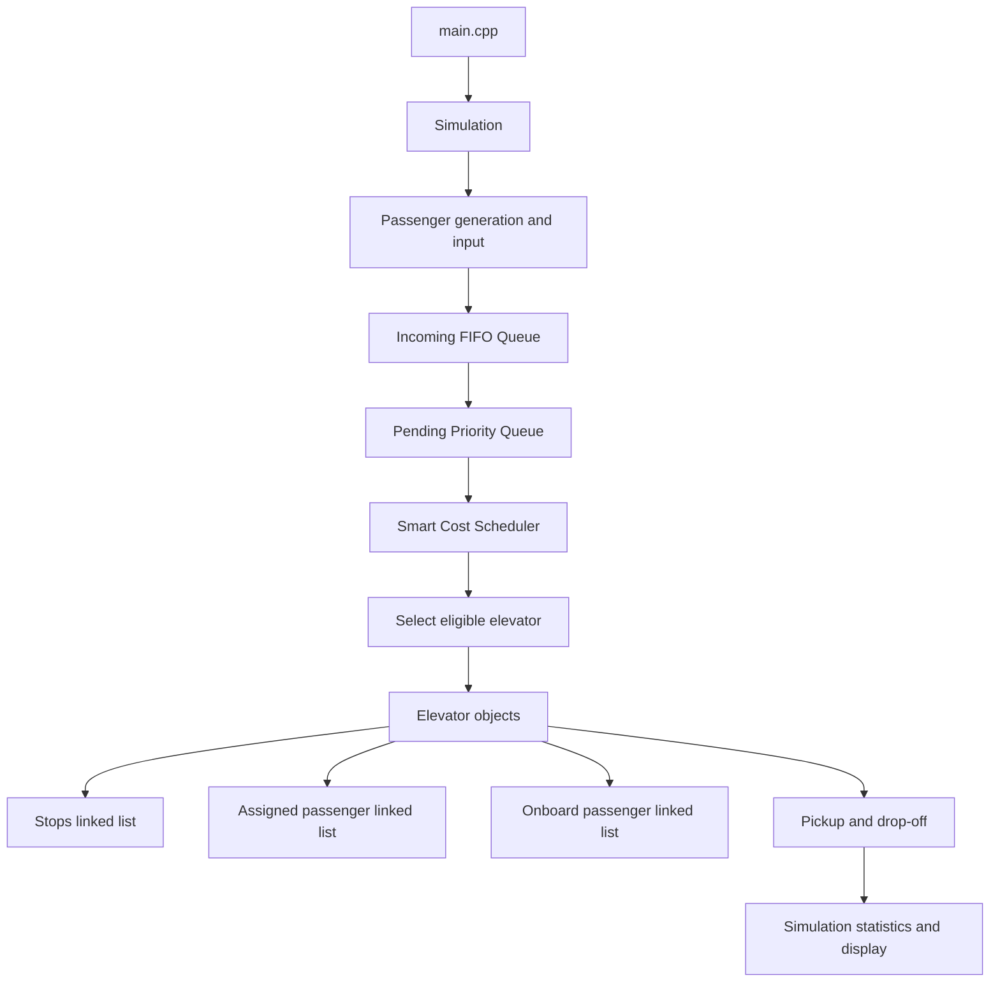
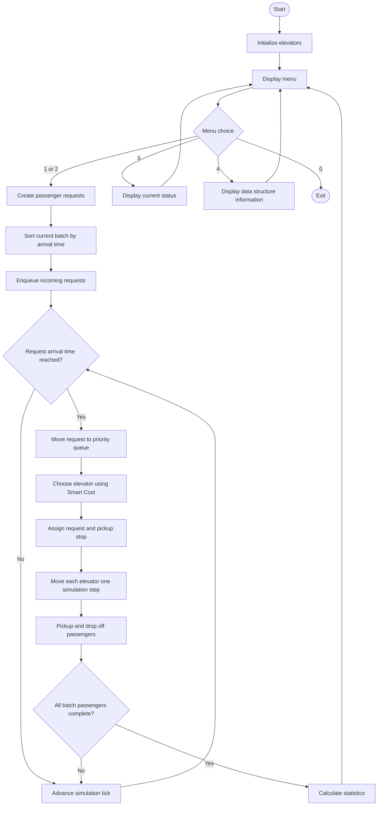

# Intelligent Elevator Dispatcher

A C++17 console simulation of a multi-elevator dispatch system. The project models passenger requests, prioritizes urgent requests, assigns requests to elevators using a Smart Cost score, and simulates elevator movement, pickup, and drop-off.

## Features

- 10 floors and 3 elevators by default.
- Passenger requests can be manually entered or randomly generated.
- Morning-rush, evening-rush, and random traffic scenarios.
- Priority queue implemented as an array-based binary max-heap.
- FIFO queue for incoming passenger requests.
- Singly linked lists for elevator stops, assigned passengers, and onboard passengers.
- Smart Cost scheduling to choose an eligible elevator.
- Live floor-by-floor console visualization.
- Persistent passenger history and elevator state between simulation runs.
- Input validation and summary statistics.

## Project structure

```text
Intelligent-Elevator-Dispatcher/
├── include/
│   ├── config.h             # System constants
│   ├── models.h             # Request and Result structures
│   ├── data_structures.h    # Linked lists, queue, priority queue
│   ├── elevator.h           # Elevator interface
│   ├── scheduler.h          # Scheduling function declarations
│   └── simulation.h         # Simulation class interface
├── src/
│   ├── data_structures.cpp  # Data structure implementations
│   ├── elevator.cpp         # Elevator movement and passenger handling
│   ├── scheduler.cpp        # Smart Cost scheduling
│   ├── simulation.cpp       # Scenarios, visualization, simulation loop
│   └── main.cpp             # Program entry point
├── Makefile
└── README.md
```

## Requirements

- A C++ compiler with C++17 support (`g++` or `clang++`)
- GNU Make

On macOS, install the compiler tools if needed:

```bash
xcode-select --install
```

On Ubuntu/Debian:

```bash
sudo apt update
sudo apt install build-essential
```

## Build and run

Build the executable:

```bash
make
```

Build and launch:

```bash
make run
```

Remove generated object files and executable:

```bash
make clean
```

## Menu options

| Option | Description |
|---|---|
| `1` | Run a simulation with randomly generated passengers |
| `2` | Enter one passenger manually and generate the remaining passengers |
| `3` | Display remembered elevator and passenger status |
| `4` | Display the data structures used |
| `0` | Exit |

During live animation, press `q` and Enter to stop the current animation.

## Architecture



## Simulation flow



## Data structures and complexity

| Structure | Use | Typical operation |
|---|---|---|
| Singly linked list | Stops and passenger collections | Insert at tail: O(1); search/remove: O(n) |
| FIFO queue | Requests waiting for their arrival/dispatch stage | Enqueue: O(1); dequeue: O(1) |
| Binary max-heap | Select highest-priority pending request | Push: O(log n); pop: O(log n); top: O(1) |
| Fixed array | Persistent passenger history and heap storage | Indexed access: O(1) |

### Priority ordering

The priority queue compares requests in this order:

1. Higher priority first (`2` before `1`).
2. Earlier arrival time first.
3. Lower passenger ID first when priority and arrival time match.

### Smart Cost scheduling

Only elevators with available assignment slots and passenger capacity are considered.

The base score is:

```text
estimated pickup time
+ 2 × number of scheduled stops
+ 3 × current elevator load
```

Additional penalties are applied for certain direction mismatches. The eligible elevator with the lowest score is selected.

## Simulation metrics

- **Average wait:** Average time from passenger arrival to pickup.
- **Average trip:** Average time from passenger arrival to destination drop-off.
- **Maximum wait:** Longest wait before pickup in the completed batch.
- **Floors travelled:** Total elevator floor movements during the batch.

## Notes

- Floors are numbered `0` through `9`; floor `0` represents the lobby.
- Priority `1` is normal and priority `2` is high.
- Passenger records are stored in a persistent fixed-size history array so linked lists can safely retain pointers to those records.
- The simulation is a discrete-time model, not a real elevator controller.
- The implementation uses a single-threaded simulation; it does not control physical elevator hardware.

## License

Add a license file if you intend to distribute or reuse this project publicly.
